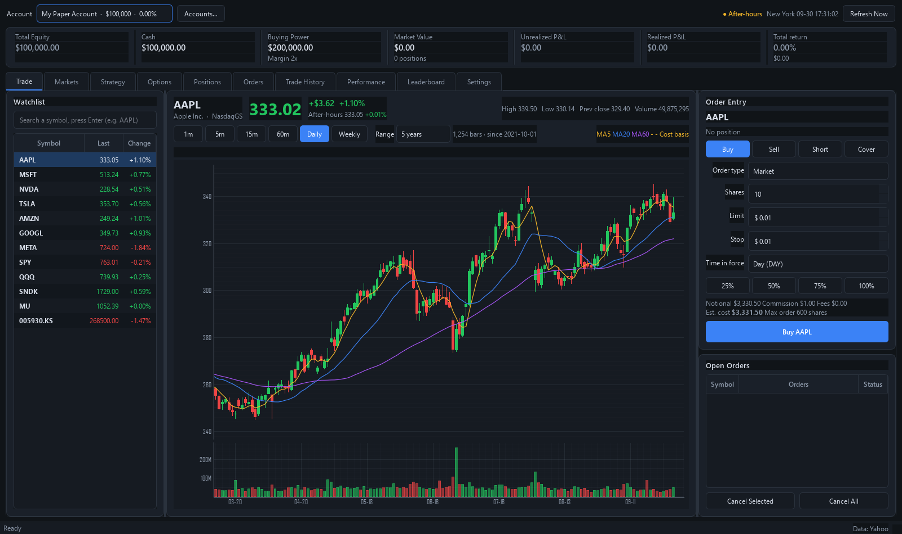
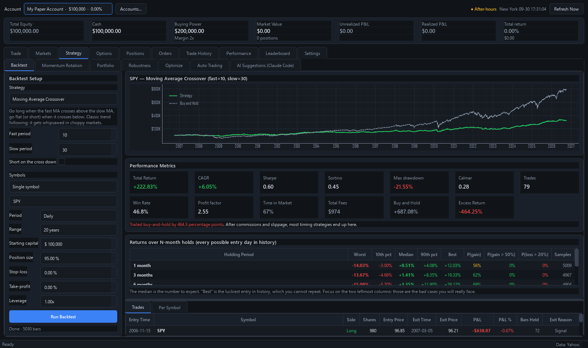

# Paper Trader — US Stock Trading Simulator

Real market data, virtual money. Not connected to any real broker; no real money involved.

**English** · [中文](README.zh-CN.md)



> **Disclaimer**
>
> This project is a **learning tool for trading simulation and backtesting**. It is not
> investment advice and not an advisory service. The strategies, preset portfolios and
> backtest results exist to demonstrate the software and **are not recommendations to buy
> or sell anything**. Past backtest results do not predict future returns. Any real
> investment decision made from it is entirely at the decision-maker's own risk.
>
> Market data comes from third-party public endpoints and may be delayed, incomplete or
> adjusted differently (see *Data sources* below). Accuracy is not guaranteed, and it must
> not be used for real trading.

## Getting started

```bash
pip install -r requirements.txt
python main.py
```

On Windows you can also double-click **`启动模拟炒股.bat`**.

The first launch creates a $100,000 margin account. When run from source, data is stored in
`data/`; the packaged `.exe` stores it in `%LOCALAPPDATA%\模拟炒股\data\` so that installing a
new version never overwrites your accounts. A snapshot is saved automatically every 20
minutes (everything from the last 48 hours is kept, one per day before that), and can be
restored from **Accounts… → Backups**.

### Language

The interface is available in **English** (default) and **Chinese**. Switch it under
**Settings → Language / 语言**; the change takes effect after a restart (the app offers to
restart for you). That settings row is intentionally bilingual, so it can be found from
either language.

## Data sources

Yahoo Finance public market data (no API key, no sign-up).

- Quotes refresh every 5 seconds by default, including pre-market and after-hours
- Candles: 1 min / 5 min / 15 min / 60 min / daily / weekly
- Free data may be delayed for some exchanges. **For practice only; not investment advice.**
- Historical candles are **dividend-adjusted**; otherwise high-yield symbols such as TLT or
  XLU would be badly understated in backtests

Yahoo has been unavailable in mainland China since November 2021, so the app falls back to
Tencent / Eastmoney when Yahoo cannot be reached. Live quotes match Yahoo exactly, but those
sources adjust for dividends differently, so multi-year backtests will differ. The source in
use is always shown in the status bar.

## What you can trade

**All US stocks and ETFs (10,000+), not just the watchlist.** Three ways to find them:

1. **Search**: type a symbol in the box at the top left of the Trade tab and press Enter
2. **Markets → Live Lists**: top gainers, top losers, most active, small-cap gainers, most
   shorted, growth tech, undervalued growth, undervalued large caps, aggressive small caps
   (up to 100 each, cached for 90 seconds)
3. **Markets → Sectors**: 20 groups such as the Magnificent Seven, semiconductors / AI,
   software / internet, China ADRs, index ETFs, leveraged ETFs, banks, energy, healthcare,
   consumer, travel / autos, retail favorites, crypto-related, defense, REITs, utilities and
   the Dow 30

Double-click any row on the Markets tab to add it to the watchlist and jump to the Trade tab.
Click a column header to sort. Keeping the watchlist under about 60 symbols keeps quote
refreshes fast.

## Features

**Trading**
- Order types: market, limit, stop, stop-limit
- Time in force: day (DAY) / good till cancelled (GTC)
- Four sides: buy, sell, short, cover
- Working orders are matched in the background on every quote update; stops trigger at
  market (or convert to limit)

**Accounts and risk**
- Margin account: approximates Reg T, 2x buying power, shorting allowed
- Cash account: no leverage, no shorting
- Pattern day trader rule: with equity below $25,000, at most 3 day trades in 5 trading
  days (can be turned off in Settings)
- Open orders reserve buying power, so you cannot over-commit

**Cost model** (configurable)
- Commission: per share (IBKR style, $0.005/share, $1 minimum, capped at 1% of notional) /
  flat per trade / zero commission
- Sell-side regulatory fees: SEC Section 31 fee + FINRA TAF
- Market order slippage: 2 basis points by default
- Cost basis includes commissions and fees, so P&L matches a real broker

**Analysis**
- Unrealized P&L, P&L %, position weights
- Equity curve, max drawdown, win rate, profit factor, average win / loss
- Fill history with CSV export
- Multi-account leaderboard: run several accounts side by side and compare returns

**Charts**
- Candles + volume + MA5 / MA20 / MA60
- Crosshair readout of any candle's OHLC
- Cost-basis line (gold dashed) and working-order price lines overlaid

## Strategies and automated trading



The **Strategy** tab has several parts, meant to be used in this order:

**1. Backtest** — 12 built-in strategies (MA crossover, EMA + ADX, RSI mean reversion,
Bollinger reversion, Donchian breakout, MACD, momentum + long-term MA, RSI(2) dip buying,
chandelier exit, volatility squeeze, trend + low-volatility filter, and a buy-and-hold
benchmark), on a single symbol, the watchlist or any sector. Reports the equity curve, CAGR,
Sharpe, Sortino, max drawdown, Calmar, win rate, profit factor, time in market and total
fees, and **always compares against buy-and-hold**.

Two hard guarantees:

- **No look-ahead bias**: a signal is computed at the close of bar *i* and filled at the open
  of bar *i+1* (an automated test checks that truncating history does not change past results)
- **Same costs as live trading**: commissions, fees and slippage come from the same settings,
  so backtest returns are not inflated

**1b. Momentum rotation** — a different mechanism from timing: instead of asking "should I buy
this one", it ranks a basket by momentum, always holds the strongest *K*, and rotates on a
schedule; with absolute momentum on, it moves to cash when everything is falling. The
benchmark is **equal-weight buy-and-hold of the same basket**, not SPY — comparing a rotation
against an index it never traded would flatter it.

**1c. Robustness test** — runs every strategy across a whole basket at once and reports how
many symbols it beats, the median excess return and the average Sharpe. This keeps you from
being fooled by one great single-stock backtest. What to look for: clearly more than half
win, a positive median excess, and an average Sharpe above the buy-and-hold row.

**1d. Rolling-window return distribution** — every backtest shows the full distribution of
"enter on any day, hold for 1 / 3 / 6 months / 1 year": worst, 10th percentile, median, 90th
percentile, best, P(gain), P(gain > 50%), P(loss > 20%). **This is the only honest way to
answer "how much can I make in a few months"** — look at the median and the worst columns,
not the best.

**1e. Leverage and liquidation** — backtests support margin (6% annual interest by default)
and simulate **margin-call liquidation** (everything is sold when equity falls below 25% of
position value). This matters: a leveraged backtest without liquidation can show a negative
account balance, which cannot happen in reality.

**1f. Portfolio** — combines several return streams (buy-and-hold / timing strategy /
momentum rotation / cash) by weight, rebalances on a schedule, and shows a **correlation
matrix**, each sleeve's own performance and the portfolio's return distribution. 9 presets
are included: four core-satellite levels plus 60/40, the Permanent Portfolio and an
All-Weather approximation. Supports risk-parity weights (inverse volatility), leverage and a
volatility target. The presets are starting points, not recommendations — run the numbers
yourself.

**2. Optimize** — grid search with a mandatory train / validation split: parameters are
searched on the first 70% of history and validated on the last 30%. **Pick parameters by the
Validation column, not the Train column.** Both are shown so that overfitting is visible: the
best-looking training result often falls apart on data it has not seen.

**3. Auto trading** — connects a validated strategy to the paper account. Risk control sits
outside the strategy: per-symbol position cap, max positions, per-trade stop-loss /
take-profit, daily trade limit and a portfolio drawdown circuit breaker. It defaults to
"advice only, no orders"; switch to automatic once you trust it. Signals use only closed
candles, and every decision is logged (time, indicator readings, reason, result).

**4. AI suggestions (Claude Code)** — no Anthropic API key needed; it uses your existing Claude
Code subscription:

1. Click **Export Briefing** → writes `data/ai/briefing.md` (account, positions, quotes,
   technical indicators, risk limits)
2. In Claude Code, say: `Read data/ai/briefing.md and write your rebalancing suggestions to
   data/ai/decisions.json in the format it describes`
3. Back in the app, click **Load AI Suggestions** → every suggestion is validated (enough
   shares, enough buying power, valid symbol)
4. Confirm each one before it executes — you always press the final button

## Options

**Paper trading for options on real market data.** The **Options** tab has three parts:

**Option chain** — the usual T layout (calls on the left, puts on the right, strikes in the
middle), with bid / ask / IV / delta / volume / open interest in each cell. Illiquid contracts
can be filtered out. Select a contract and the right side shows its **odds profile**:

> Buy 2 AAPL 2026-10-02 $345 Call @ ask 3.15
> You pay $631.30　Breakeven 348.15 (the stock needs to rise 4.8%)
> Finishes ITM 26%　**Actually profitable 21%**　Time decay per day $35.54　Max loss $630 (100%)

Prices always use the market bid / ask (buys pay the ask, sells hit the bid). Option spreads
are wide, and filling at the midpoint would be fooling yourself.

**Positions** — delta / theta / intrinsic value / time value / days left for each position,
plus **portfolio Greeks** (total delta as a share equivalent, theta decay per day in dollars).
Expiration is handled automatically: out-of-the-money contracts expire worthless,
in-the-money contracts are exercised into stock, and short positions are assigned.

**Strategy builder** — 9 preset structures (long call, long put, cash-secured put, covered
call, bull call spread, bear put spread, straddle, strangle, iron condor). Strikes are picked
from the current chain automatically, and it draws a **payoff-at-expiry chart** (shaded
profit / loss areas, breakeven lines, current P&L as a dashed line), with net debit / credit,
max profit, max loss and breakevens. All legs can be placed in one go.

Short options require margin (approximating Reg T); covered calls need none extra, and cash
accounts cannot write naked options. Buying options must be paid in full (options have no
loan value).

**Option backtesting is not possible** — Yahoo does not provide history for expired contracts
(all 404 in testing). Backtesting on Black-Scholes prices synthesized from historical
volatility gave a median error of 24% (51% out of the money), which is not useful. A paid
source would be needed (Polygon from $29/month); the `OptionDataSource` interface is already
in place for it.

## Tips

- Type a symbol in the search box and press Enter; double-click a result to add it to the
  watchlist
- The **Markets** tab has live lists and sectors; double-click a row to start trading it
- Right-click the watchlist to remove or reorder symbols
- Double-click a row on the Positions tab to jump to the Trade tab with a closing order filled in
- The 25% / 50% / 75% / 100% buttons size the order from your current buying power

## Project layout

```
main.py              entry point
pt/config.py         settings, commission and fee model
pt/i18n.py           interface language: _tr() translates, N_() marks without translating
pt/lang/             English translation tables (keys are the Chinese source strings)
pt/market.py         market data client (quotes, candles, search, lists)
pt/eastmoney.py      mainland China fallback sources (Tencent / Eastmoney)
pt/universe.py       sector groups and list definitions
pt/models.py         orders / fills / positions / accounts
pt/engine.py         matching engine, P&L accounting, Reg T and PDT rules
pt/storage.py        account persistence (atomic writes, fsync, automatic snapshots)
pt/cache.py          local candle cache
pt/options/          options: pricing and Greeks, chains, trading and expiration
pt/strategy/         strategies, indicators, backtests, rotation, optimization,
                     walk-forward validation, auto trading, AI bridge
pt/ui/               interface (main window, markets, charts, workers, theme)
tools/check_lang.py  translation checker (missing entries, mismatched placeholders)
tools/build_exe.py   packages a standalone Windows build
data/                accounts and settings (generated automatically)
```

## Adding interface text

Write any user-facing Chinese text as `_tr("中文")` and add the English line to the matching
file under `pt/lang/`. Then run:

```bash
python tools/check_lang.py
```

It reports missing translations, mismatched `{}` / `%s` placeholders (it actually formats
each translation with dummy arguments), and leftover Chinese. Names that are saved to disk
or used as lookup keys use `N_("中文")` instead, and are translated only when displayed —
see rule 18 in `CLAUDE.md`.

## Requirements

PyQt6, pyqtgraph, requests, tzdata — see `requirements.txt`.
